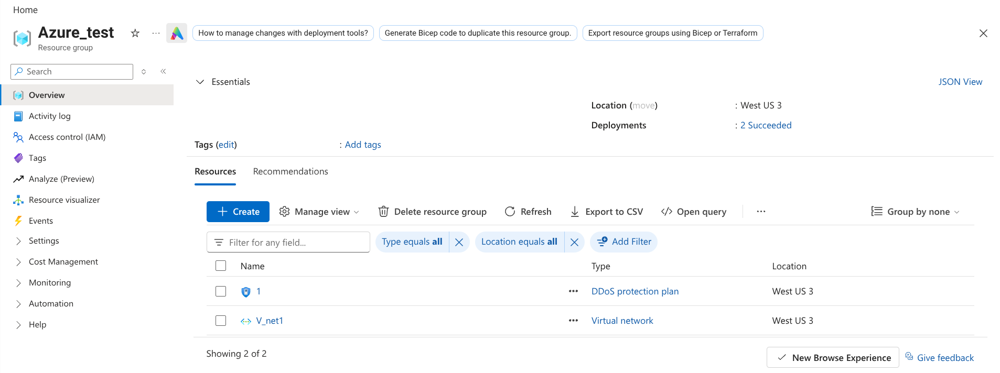
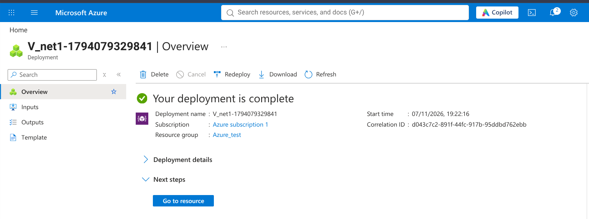
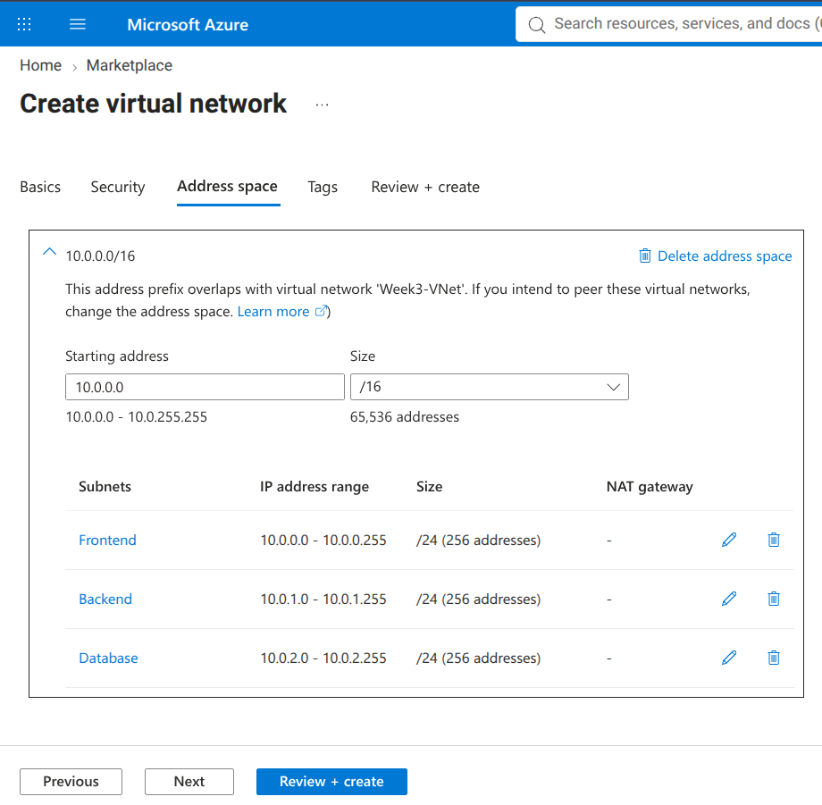
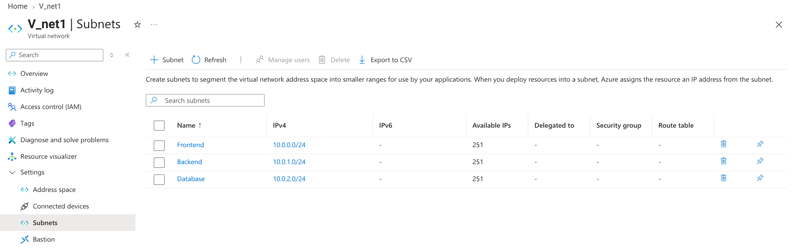

# Azure Virtual Network Deployment

## Overview
This practical lab demonstrates the deployment
and configuration of foundational network
infrastructure in Microsoft Azure.

## Objectives
- Deploy an Azure Resource Group.
- Create an Azure Virtual Network (VNet).
- Configure IPv4 address space and subnetting.
- Verify the deployed network configuration.

## Technologies Used
- Microsoft Azure
- Azure Portal
- Azure Virtual Network
- IPv4 and CIDR addressing

## Network Configuration

| Configuration | Value |
|---|---|
| Resource Group | [Azure_test] |
| Azure Region | [West US 3] |
| Virtual Network | [V_net1] |
| VNet Address Space | [10.0.0.0/16] |

### Subnet Configuration

| Subnet Name | Address Range | Intended Purpose |
|---|---|---|
| Frontend | [10.0.0.0/24] | Web-facing applications |
| Backend | [10.0.0.0/24] | Application processing |
| Database | [10.0.0.0/24] | Database workloads |

## Implementation

### 1. Resource Group Deployment
Created a resource group to organise and manage
the Azure networking resources.

### 2. Virtual Network Deployment
Deployed a virtual network and configured its
IPv4 address space.

### 3. Subnet Configuration
Created a subnet within the virtual network's
allocated address space.

### 4. Configuration Verification
Reviewed the subnet configuration in Azure
Portal to confirm its deployment.

## Technical Understanding
- A resource group logically organises Azure resources.
- A virtual network provides a private networking
  environment for Azure resources.
- Subnets divide the virtual network address space
  into smaller network segments.
- CIDR notation defines the size of an IP address range.

## Design Decisions

### Subnet Segmentation
I divided the virtual network into three subnets
(Frontend, Backend and Database) to establish
the foundation of a three-tier architecture.

This allows different application workloads to
be logically organised according to their
purpose and responsibilities.

### IP Address Allocation
Each subnet was assigned a unique, non-overlapping
IP address range within the virtual network's
address space.

This prevents address range conflicts and enables
Azure to correctly route traffic between subnets.

### Network Security and Traffic Management
Separating workloads into dedicated subnets
provides greater flexibility when implementing
network security and traffic management controls.

Network Security Groups (NSGs) can be introduced
to control traffic between subnets, restrict
unauthorised access and reduce unnecessary
exposure of backend and database resources.

Subnet separation alone does not restrict traffic.
Additional security controls are required.

## Outcome

Successfully deployed a foundational Azure network
environment consisting of a Resource Group,
a Virtual Network and three dedicated subnets.

Verified the network configuration through the
Azure Portal, ensuring that each subnet had a
unique address range within the VNet address space.

This deployment demonstrates practical knowledge
of Azure resource management, virtual networking,
CIDR addressing and subnet segmentation.

The infrastructure establishes a foundation for
future workload deployment, network security,
connectivity testing and infrastructure automation.

## Future Enhancements
- Network Security Groups (NSGs)
- VNet peering
- Virtual machine connectivity
- Routing and network troubleshooting
- Infrastructure as Code deployment
