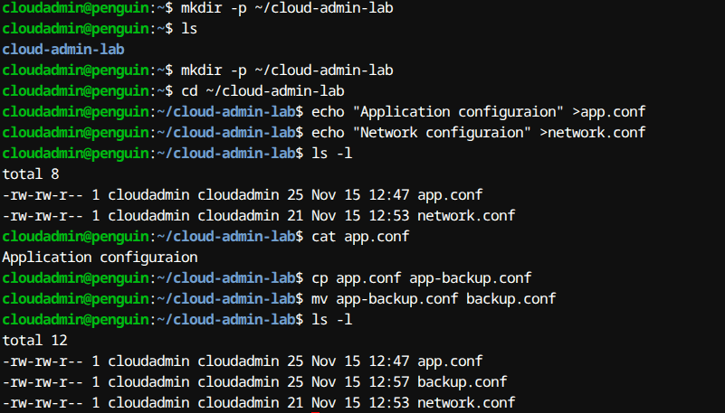

# Linux and Bash Fundamentals

## Overview
A practical Linux administration and Bash
scripting lab focused on file management
and basic operational automation.

## Skills Demonstrated
- Linux command-line navigation
- File and directory management
- File permissions
- Bash variables
- Loops and conditional statements
- Error detection and exit codes

## Business Scenario
Automate the verification of required application
configuration files to identify missing files.

## Linux File Management

## Bash Automation
Developed a Bash script that checks whether
required configuration files exist.

[View Bash Script](check-files.sh)

## Testing

### Failure Test
Simulated a missing configuration file by renaming
network.conf. The script correctly detected the
missing file and returned exit code 1.

### Successful Test
The script confirmed that both configuration files
were present and returned exit code 0.

### Recovery
Restored the missing configuration file and
successfully reran the script, confirming that
normal operation had been restored.

## Lessons Learned

- Developed practical experience using Linux commands
  to navigate directories, manage files and inspect
  file permissions.

- Learned how Bash scripting can automate repetitive
  system administration tasks, reducing manual effort
  and improving operational efficiency.

- Used variables, loops and conditional statements
  to check for required configuration files and
  identify missing files.

- Understood how file permissions control access
  and execution, including using chmod to make
  a script executable.

- Learned how exit codes communicate the outcome of
  a script, with 0 indicating success and 1 indicating
  a detected failure in this implementation.

- Recognised the importance of testing both successful
  and unsuccessful scenarios to ensure scripts behave
  as expected.

## Future Enhancements
- System health monitoring
- Disk space monitoring
- Automated logging
- Cloud infrastructure administration
